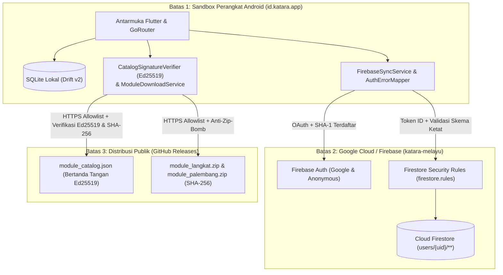

# Model Ancaman (Threat Model — STRIDE) — KATARA (`v1.1.1`)

Dokumen ini memetakan aset kritis, aktor ancaman, batas kepercayaan (*trust boundaries*), titik masuk (*entry points*), dan mitigasi keamanan berdasarkan kerangka **STRIDE** (*Spoofing, Tampering, Repudiation, Information Disclosure, Denial of Service, Elevation of Privilege*).

---

## 1. Aset Kritis (Assets)

| ID Aset | Nama Aset | Deskripsi & Sensitivitas |
| --- | --- | --- |
| `AST-01` | **Progres & Statistik Belajar Pengguna** | Data XP, streak, bintang pelajaran, dan penguasaan kata SRS di SQLite lokal & Cloud Firestore (`users/{uid}/**`). |
| `AST-02` | **Kredensial & Sesi Autentikasi** | Token ID Firebase Auth, sesi OAuth Google Sign-In, serta pemetaan akun Tamu (anonim) ke akun permanen. |
| `AST-03` | **Integritas Korpus Bahasa & Budaya** | Modul bawaan Melayu Deli (`ms-deli`) dan modul unduhan Melayu Langkat (`ms-langkat`) & Melayu Palembang (`ms-palembang`). |
| `AST-04` | **Kunci Kriptografi Pengembang** | Kunci privat Ed25519 penandatangan katalog (`.keys/catalog_ed25519.seed`) dan keystore rilis Android (`.jks`). |
| `AST-05` | **Kuota & Ketersediaan Layanan Cloud** | Kuota baca/tulis harian Cloud Firestore dan Firebase Authentication pada proyek `katara-melayu`. |

---

## 2. Batas Kepercayaan (Trust Boundaries)

---

## 3. Analisis Ancaman STRIDE & Mitigasi

| Kategori STRIDE | Ancaman Konkret | Titik Masuk (*Entry Point*) | Mitigasi yang Diterapkan di KATARA `v1.1.1` |
| --- | --- | --- | --- |
| **S — Spoofing** | Penyerang memalsukan `module_catalog.json` atau mengarahkan unduhan modul ke server palsu. | `ModuleDownloadService.loadCatalogEnvelope`, `_fetchModuleBytes` | Verifikasi tanda tangan digital **Ed25519 (RFC 8032)** dengan kunci publik tertanam (`57ee50c3b50ecc5775b50a45e6c2d67e3cb03a4a977be93caf156b88cd145466`) + daftar putih HTTPS khusus domain resmi GitHub Releases. |
| **S — Spoofing** | Aplikasi kloning/bajakan mencoba menggunakan konfigurasi OAuth Google Sign-In milik `id.katara.app`. | `FirebaseSyncService.signInWithGoogle` | Pembatasan pasangan nama paket `id.katara.app` dan sidik jari sertifikat SHA-1/SHA-256 terdaftar di proyek Firebase `katara-melayu`. |
| **T — Tampering** | Paket modul ZIP dimodifikasi di tengah jalan atau berisi entri yang mencoba menimpa kosakata bawaan `ms-deli`. | `verifyAndExtractArchive`, `validateExtractedModuleDirectory` | Verifikasi hash **SHA-256 (64 hex)** sebelum ekstraksi, validasi skema JSON ketat, penolakan eksplisit `courseId == 'ms-deli'` atau ID berawalan `ms-deli:`, serta proteksi anti-downgrade versi modul. |
| **T — Tampering** | Klien memanipulasi permintaan REST Firestore untuk menulis nilai `stars: 99`, `delta_xp: 999999`, atau field sampah. | Cloud Firestore (`users/{uid}/**`) | `firestore.rules` menegakkan `hasOnlyAllowedFields`, rentang integer (`stars` `0..3`, `best_score` `0..100`, `delta_xp` `1..500`), dan batas panjang string/list. |
| **R — Repudiation** | Ketidakjelasan asal-usul perubahan progres saat sinkronisasi multi-perangkat. | `sync_queue`, `xp_events`, `ConflictResolver` | Pencatatan `event_id` unik (idempoten), `device_id`, `revision` monotonik, dan stempel waktu ISO-8601 pada setiap entitas yang disinkronkan. |
| **I — Information Disclosure** | Kebocoran `PlatformException` mentah ke layar pengguna, catatan audit internal kurator di UI, atau ekstraksi DB via `adb backup`. | `ProfileScreen`, `WordModel`, `AndroidManifest.xml` | `AuthErrorMapper` menyembunyikan detail teknis di balik `kDebugMode`; `WordModel.sanitizeUserNotes` menghapus prefix audit internal; `android:allowBackup="false"` dan `usesCleartextTraffic="false"` aktif di `AndroidManifest.xml`. |
| **D — Denial of Service** | Serangan *Decompression Bomb* (*Zip-Bomb*) atau *Zip-Slip* yang menghabiskan memori/penyimpanan perangkat. | `ModuleDownloadService.verifyAndExtractArchive` | Batas unduhan `25 MB`, batas berkas tunggal `10 MB`, batas total ekstraksi `30 MB`, batas rasio kompresi `30:1`, maksimal `64` berkas, daftar putih nama berkas `.json`, dan pembersihan `.tmp` saat startup. |
| **E — Elevation of Privilege** | Pengguna A mencoba membaca, mengubah, atau menghapus dokumen milik Pengguna B di Cloud Firestore, atau mengakses rute `/dev/gallery` di build rilis. | Cloud Firestore & `GoRouter` | `firestore.rules` mewajibkan `request.auth != null && request.auth.uid == uid` dengan aturan penolakan bawaan (`allow read, write: if false`); rute `/dev/gallery` dikunci dengan `kDebugMode`. |
